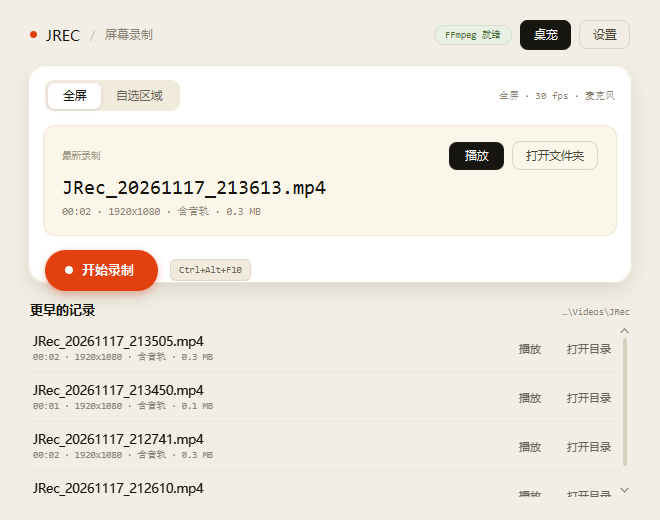
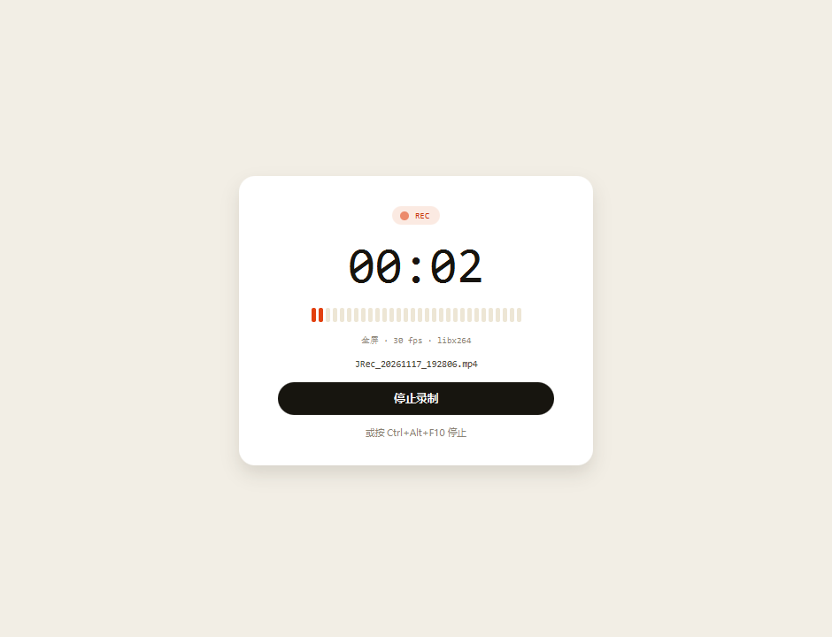
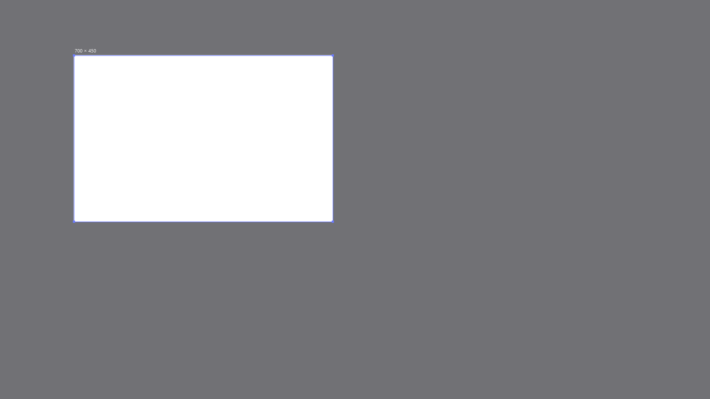
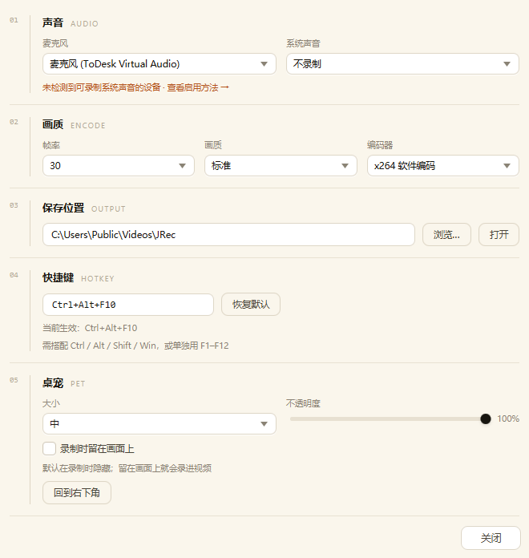

# JRec

用 Java 写的跨平台屏幕录制工具。全屏或框选一块区域，录下画面与声音，输出标准 MP4。

桌面端已实现并实测通过；Android 端在路线图里（见[已知限制](#已知限制)）。

**产品页：https://fangtangj.github.io/jrec/**



桌宠（透明置顶，单击开始录制，右键更多）：


勾选「录制时留在画面上」后会带一个 REC 标记（代价是它会被录进视频）：


## 特性

| 能力 | 状态 | 说明 |
|---|---|---|
| 全屏录制 | 已实现 · 已实测 | 覆盖全部显示器 |
| 自选区域录制 | 已实现 · 已实测 | 拖框选择，采集时就裁剪，不做二次重编码 |
| 麦克风录制 | 已实现 · 已实测 | DirectShow 设备枚举 |
| 系统声音录制 | 已实现 | Windows 需系统存在回环设备，见[说明](#windows-上录不到系统声音) |
| 麦克风 + 系统声音混音 | 已实现 | 单条 AAC 音轨，`amix` 混流 |
| 硬件编码 | 已实现 | 自动探测 NVENC / QSV / AMF，可选 |
| 最新录制 | 已实现 · 已实测 | 窗口正中显示最近一条，一键播放或定位到文件夹 |
| 录制历史 | 已实现 · 已实测 | 时长、分辨率、音轨、体积、播放、打开目录 |
| 桌面宠物 | 已实现 · 已实测 | 透明置顶小人：单击起停、双击看最新、拖动贴边、会眨眼、偶尔蹦一下 |
| 全局快捷键 | 已实现 · 已实测 | Ctrl+Alt+R 起停；可在设置里改键，占用时提示并保留旧绑定 |
| 悬浮控制条 | 已实现 · 已实测 | 录制时主窗口最小化，置顶小条显示计时，可拖动、可隐藏 |
| 免安装包 | 已实现 · 已实测 | `build-dist.bat` 产出 `dist\JRec\JRec.exe`，自带 JRE，双击即用 |
| 首次启动自动装 FFmpeg | 已实现 | 下载到 `~/.jrec/bin`，仓库不带二进制 |
| 暂停 / 继续 | 未实现 | 见路线图 |
| Android 端 | 未实现 | 见路线图 |

录制中：



框选区域（离屏渲染，背景的桌面内容不在快照里，所以是灰的）：



悬浮控制条（录制时置顶，主窗口已最小化）：


## 怎么打开

**Windows 上直接用**：双击 `dist\JRec\JRec.exe`（或仓库根目录的 `JRec.bat`）。
那个目录自带 Java 运行时，**不需要另装 JDK**，拷到别的机器上也能跑。

仓库里不存这个产物（140 MB，且每次构建都能重造），第一次要先打一次包：

```bat
build-dist.bat
```

脚本就是 `mvn package` + 收集依赖 + `jpackage`，产物在 `dist\JRec\`。需要 JDK 17+，`jpackage` 随 JDK 提供。

**从源码跑（开发用）**，需要 **JDK 17+** 和 **Maven 3.8+**，不需要预装 FFmpeg：

```bash
git clone <this-repo>
cd jrec
mvn install -DskipTests

cd jrec-desktop
mvn javafx:run
```

首次启动若本机没有 FFmpeg，界面会提示并提供一键下载（约 80 MB，装到 `~/.jrec/bin/ffmpeg.exe`，不污染系统 PATH）。

想用自己的 FFmpeg：

```bash
mvn javafx:run -Djrec.ffmpeg=/path/to/ffmpeg
# 或设置环境变量 JREC_FFMPEG
```

## 快捷键

默认 `Ctrl+Alt+R` 开始 / 停止。**它可能会被别的程序占用**——这不是假设，开发机上 `Ctrl+Alt+R` 就注册失败（Win32 错误 1409），程序会自动退到候选列表里第一个空闲的组合，界面右下角显示实际绑到的那个。

想改成自己的键：**设置 → 04 快捷键 → 点进输入框 → 直接按下想要的组合**。组合需要带 `Ctrl` / `Alt` / `Shift` / `Win`，或者单独用 `F1`–`F12`；只按一个字母不会生效，否则那个键会在全系统被吞掉。

- 改键时如果新组合已被别的程序占用，会当场提示并**保留原来的绑定**，不会让你落到「没有快捷键」的状态。
- 打开设置面板期间，已绑定的快捷键会被临时释放——否则你按下的组合会被它自己截走，根本录不进去。
- 选择存在 `java.util.prefs`（`com.rzx.jrec.desktop` 下），重启后仍在。「恢复默认」清掉它。

## 桌宠

| 操作 | 效果 |
|---|---|
| 单击 | 开始 / 停止录制 |
| 双击 | 打开最近一次录制 |
| 拖动 | 移位；靠近屏幕边缘会自动贴齐，位置记在 `java.util.prefs` 里 |
| 右键 | 主窗口 / 打开最新 / 打开文件夹 / **大小** / 隐藏 / 退出 |
| 悬停 | 冒出一句提示 |

设置 → **05 桌宠** 可以调**大小**（小 / 中 / 大）、**不透明度**（35%–100%）、
**录制时是否留在画面上**，以及「回到右下角」。

**默认录制时它会躲起来。** `gdigrab` 没法把一个窗口排除在录制之外——一条小人在角落里
待着，就会出现在你每一段录像里。需要它出镜（比如录教程时当解说角色），勾上那一项，
它会改成带 REC 标记的形态留在原地。

动画分四层，都在同一个呼吸节奏里：**浮动**几个像素、**轻微摆动**、每 3–7 秒**眨一次眼**、
每 9–17 秒**蹦一下**。录制时节奏加快。眨眼帧是用同一张画出来的（把眼睛区域填成肤色再压一条
闭眼线），不是第二套表情；两张图不同步的时机由随机间隔控制，因为任何精确周期在一分钟内
就会被看出是循环。

桌宠要覆盖在别人正在做的事情上面，所以幅度刻意做得都很小。



## 为什么这样设计

这几个决定是这个项目里真正花时间的部分，也是面试时能讲的东西。

**不用 JavaCV，直接调 FFmpeg 命令行。** JavaCV 会把 200MB+ 的原生库塞进依赖，而它封装的恰恰是一条命令行。直接 `ProcessBuilder` 调二进制的好处：区域录制只是 `-offset_x/-offset_y/-video_size` 三个参数；出错时 FFmpeg 的 stderr 能逐行接住并展示给用户；`jrec-core` 的运行时依赖是**零**。

**不用 `java.awt.Robot` 逐帧抓屏。** 实测 1080p 下 `Robot` 只有 10~15 帧，且抓不到系统声音，音视频同步要自己写。这条路只在导师禁止调用 FFmpeg 时才值得走。

**停止录制发 `q`，不是 `kill`。** 直接杀进程会让 MP4 缺少 `moov` 索引，文件打不开。FFmpeg 接受 stdin 上的 `q` 来正常收尾，所以停止走这条路径，只有 15 秒不响应才降级为强制结束。（这个行为在本项目的 Windows + FFmpeg 6.0 上实测过，见 `RecorderLiveTest`。）

**区域录制在采集端裁剪。** `gdigrab` 支持只读一块矩形，所以编码器从头到尾只看到用户选的那块，不做「录全屏再裁」的浪费。macOS 的 `avfoundation` 不支持采集时裁剪，只能退回 `crop` 滤镜——这也是 macOS 区域录制更费 CPU 的原因，代码里写明了。

**录制核心不依赖任何 UI。** `jrec-core` 里没有一行 JavaFX，所以录制引擎可以在无界面环境下被测试驱动。

## 模块

```
jrec/
├── jrec-core/       录制引擎：FFmpeg 定位与下载、音频设备探测、命令行拼装、进程生命周期
└── jrec-desktop/    JavaFX 客户端：预览主界面、悬浮控制条、区域框选遮罩、录制历史
```

核心类：

| 类 | 职责 |
|---|---|
| `Recorder` | 一次录制的状态机：start → recording → stopping → finished/failed |
| `CommandBuilder` | 纯函数，把配置 + 平台后端拼成参数数组，可单测 |
| `CaptureBackend` | 平台差异的唯一出口（Windows / Linux / macOS 三个实现） |
| `FfmpegLocator` / `FfmpegDownloader` | 找 FFmpeg，找不到就装 |
| `AudioDevices` | 枚举音频设备，并按名字判断哪个是系统声音回环 |
| `MediaProbe` | 从一个成品文件里读出时长、分辨率、有无音轨 |

## 实测情况

Windows 11 + JDK 17 + FFmpeg 6.0（gyan.dev essentials 构建）：

| 验证项 | 结果 |
|---|---|
| 全屏录制 1920×1080 | 通过，产物 3.00s / H.264 |
| 区域录制 800×600 @ (100,100) | 通过，产物精确 **800×600**，非缩放 |
| 视频 + 麦克风混录 | 通过，AAC 48kHz 立体声，音轨存在 |
| 中文/括号设备名（`麦克风 (ToDesk Virtual Audio)`） | 通过 |
| stdin 发 `q` 优雅停止 | 通过，exit code 0，文件可播放 |
| 框选遮罩拖动选区 | 通过，200,150 → 900,600 得到 `700x450@200,150` |
| UI 全流程（点开始→录→点停止→保存→列表出现） | 通过，产物 1.3 MB |
| 全局快捷键注册 | 通过，`Ctrl+Alt+R` 在本机被占用（Win32 1409），自动降到 `Ctrl+Alt+S` |
| 悬浮控制条 | 通过，144×42，录制时主窗口最小化、停止后恢复 |
| 单元测试 + 实拍测试 | `mvn test` 共 15 项全绿 |

复现测试：

```bash
cd jrec
mvn test -Djrec.ffmpeg=/path/to/ffmpeg
```

没有 FFmpeg 的机器上，实拍测试会自动跳过而不是失败。

## 已知限制

**macOS / Linux 已实现但未实测。** 代码路径写完了（`x11grab` + `pulse`，`avfoundation`），但这台开发机是 Windows，没有真机验证。用这两个平台的人需要自己承担风险。

**Windows 上录不到系统声音。**
Windows 不默认开放系统声音的录制通道。需要满足其中一条：

1. 「声音设置 → 更多声音设置 → 录制」里右键空白处，勾选「显示已禁用的设备」，再启用「立体声混音 / Stereo Mix」；
2. 装虚拟声卡（VB-Audio Virtual Cable、VoiceMeeter 等），把系统播放输出指向它。

界面检测不到回环设备时，会显示一行橙字并可点击查看这段说明。

**混合 DPI 多显示器会裁歪。** 区域框选用光标所在屏幕的缩放比换算物理像素，一台 150% 一台 100% 的配置下无法同时正确。系统声音、区域录制在单屏或同缩放多屏上是准的。

**长录制没有崩溃保护。** 录制中进程若被强杀，MP4 没有 `moov` 索引，文件作废。专业做法是先写 MKV 再转封装，已在路线图里。

**暂停/继续未做。** FFmpeg 没有原生暂停，正确做法是分段录制再 `concat`，工作量不小，还没排上。

**全局快捷键只在 Windows 上有效。** Linux 和 macOS 各需要自己的原生调用（`XGrabKey`、`RegisterEventHotKey`），本项目还没写；界面上会直接显示「无全局快捷键」，而不是给一个按不响的提示。

**悬浮条会出现在全屏录制里。** 它是真实的置顶窗口，`gdigrab` 没有窗口排除能力。把它拖到副屏角落，或点「×」收起来——收起后快捷键照样能停。

## 路线图

- [ ] Android 客户端（`MediaProjection` + `MediaRecorder`，Java）
- [ ] 暂停 / 继续（分段录制 + concat 无损拼接）
- [ ] 崩溃安全录制（先落 MKV，停止时无损转 MP4）
- [ ] 录制后自动生成缩略图与分享页

## 开发工具

`jrec-desktop/src/main/java/com/rzx/jrec/desktop/dev/` 下有三个不参与产品逻辑的工具：

- `UiSnapshot`：把窗口离屏渲染成 PNG，用来生成 README 里的截图，不依赖桌面状态。
- `UiFlowProbe`：驱动真实界面走完一次「开始→录 4 秒→停止→保存」，用来验证 UI 接线（监听器、视图切换、计时器、历史刷新），并顺带产出录制态截图。
- `UiRegionProbe`：向框选遮罩合成鼠标事件，验证拖动选区能产出正确的坐标与尺寸（实测 200,150 → 900,600 得到 `700x450@200,150`）。

运行方式（需 JavaFX 在 module path 上）：

```bash
java --module-path <javafx jars> --add-modules javafx.controls \
     -cp "jrec-desktop/target/classes;jrec-core/target/classes" \
     com.rzx.jrec.desktop.dev.UiFlowProbe <输出目录>
```

## License

MIT
